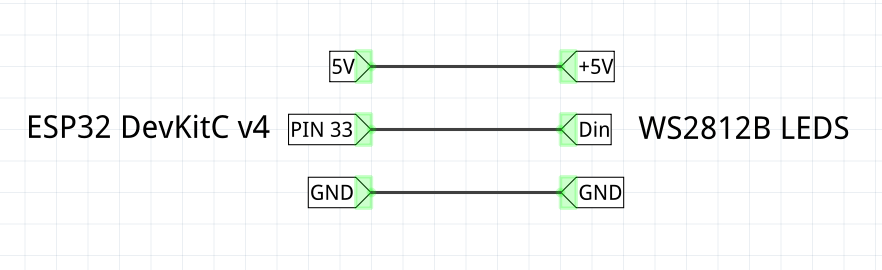

# Color changing night light

ESP32 night light with a WS2812B LED strip inside a 3D printed figure, controlled over Bluetooth
Low Energy from a phone. Figure taken from [thingiverse](https://www.thingiverse.com/thing:5220507).

- Firmware in Rust (this folder).
- Web app to control it from a phone or computer: [`web/`](web).
- The original Arduino sketch is kept as an example in [`arduino/`](arduino) (no Bluetooth).

[TOC]

## Hardware

* WS2812B LED strip (5V)
* ESP32 DevKitC v4

### Wiring

The LED strip data line goes to **GPIO33**.



## Firmware

### Toolchain setup

The ESP32 (Xtensa) needs Espressif's Rust toolchain:

```sh
cargo install espup espflash
espup install            # installs the `esp` toolchain and writes ~/export-esp.sh
```

Before building in a new shell, load the environment so the Xtensa linker is on `PATH`:

```sh
. ~/export-esp.sh
```

### Build and flash

Connect the board over USB, then:

```sh
cargo run --release      # build, flash and open the serial monitor
cargo build --release    # build only
```

### Choosing the figure

Each figure has a different number of LEDs. Pick one with a Cargo feature (only one at a time):

| Feature            | LEDs |
|--------------------|-----:|
| `dinosaur` (default) | 22 |
| `duck`             | 20 |
| `tanjiro`          | 18 |
| `banyetes`         | 16 |
| `test`             | 15 |

```sh
cargo run --release --no-default-features --features duck
```

Enabling two figures at once is a compile error.

### Tuning

Brightness, pulse range and animation speeds are constants at the top of [`src/main.rs`](src/main.rs):
`BRIGHTNESS`, `PULSE_MIN`, `PULSE_PERIOD_MS`, `RAINBOW_PERIOD_MS`, `RAINBOW_SPAN_DEG` (how much
of the color wheel is visible along the strip).

LEDs are refreshed at 200 Hz (`FRAME_MS = 5`) with temporal dithering, like FastLED does: at
low brightness each channel only has a few real levels, so the fraction is spread over successive
frames. Don't raise `FRAME_MS` much, or the dithering becomes visible as flicker.

### Logging

The log level is set at build time by `ESP_LOG` in [`.cargo/config.toml`](.cargo/config.toml)
(default `info`). It accepts per-module filters, for example:

```sh
ESP_LOG="info,trouble_host=warn" cargo run --release
```

## BLE protocol

The device advertises as **`led_light`** with one custom service. Writes with an invalid value
are rejected with an ATT error.

Service UUID: `937312e0-2354-11eb-9f10-fbc30a62cf38`

| Characteristic | UUID | Access | Format |
|---|---|---|---|
| Mode  | `937312e0-2354-11eb-9f10-fbc30a62cf38` | read, write | 1 byte: `0` rainbow, `1` fixed, `2` pulsating. Other values are rejected (`Value Not Allowed`). |
| Color | `987312e0-2354-11eb-9f10-fbc30a62cf38` | read, write | 3 bytes: `R G B` (0-255 each). Any other length is rejected (`Invalid Attribute Value Length`). |

- The service and the Mode characteristic share a UUID. This is kept from the first firmware
  so existing clients keep working.
- At boot the mode is rainbow and the color is red (`FF 00 00`). Nothing is saved across reboots.
- The Color is used by the fixed and pulsating modes.
- The BLE address is a static random address derived from the chip MAC, so it stays the same
  across reboots.

### Controlling it from a phone

Use the web app in [`web/`](web) (Chrome on Android, Bluefy on iPhone). For raw testing, a
generic BLE app such as nRF Connect works too:

1. Scan and connect to `led_light`.
2. Open the service `937312e0-…`.
3. Write `02` to Mode for pulsating, then `00FF00` to Color for green.

## Implementation notes

- Stack: [esp-hal](https://github.com/esp-rs/esp-hal) 1.2, esp-rtos (scheduler + Embassy executor),
  esp-radio (BLE controller), [trouble-host](https://github.com/embassy-rs/trouble) (BLE host / GATT),
  esp-hal-smartled (WS2812B over RMT).
- `esp-radio` is pinned to `=1.0.0-beta.1`, the only release compatible with esp-hal 1.2.
  `trouble-host` stays on 0.7 because 0.8 needs a newer `bt-hci` than esp-radio uses.
- **ROM symbol workaround:** the ESP32 BLE blob needs three ROM functions missing from
  `esp-rom-sys` 0.1.5. [`ld/esp32_rom_bt_fix.x`](ld/esp32_rom_bt_fix.x) provides them (addresses from
  ESP-IDF's `esp32.rom.ld`) and [`build.rs`](build.rs) passes it to the linker. Remove both once
  `esp-rom-sys` includes them; the build will fail with `undefined reference to ld_iscan_evt_start_cbk`
  if they are still needed.

## Layout

```
src/main.rs             firmware: setup, BLE GATT server, LED task
ld/esp32_rom_bt_fix.x   missing ESP32 ROM symbols (see above)
build.rs                adds the linker script above
.cargo/config.toml      target, linker flags, flash runner, log level
web/                    Web Bluetooth control app (static page)
arduino/                original Arduino sketch, kept as an example
wiring.png, wiring.fzz  wiring diagram (Fritzing)
```

## Arduino example

[`arduino/arduino.ino`](arduino/arduino.ino) is the original FastLED sketch: a rainbow animation
with no Bluetooth control. Set the number of LEDs (`NUM_LEDS`) and `BRIGHTNESS` for the figure in
the sketch before uploading.

Compile and upload with the `DOIT ESP32 DEVKIT V1` board.

### Install ESP32 support for Arduino IDE

Source [link](https://randomnerdtutorials.com/installing-esp32-arduino-ide-2-0/)

Go to `File > Preferences` and add the following to `Additional Boards Manager URLs` (several urls can be separated by commas):

```plain
https://dl.espressif.com/dl/package_esp32_index.json
```

Open `Tools > Board > Boards Manager` and search and install:

* esp32 by Espressif Systems (1.0.6 on 18/02/2023).

Also install the following packages:

```bash
sudo apt install python3-serial python-is-python3
```

Finally, in the Arduino libraries install:

* FastLED by Daniel Garcia (3.5.0 on 18/02/2023)
